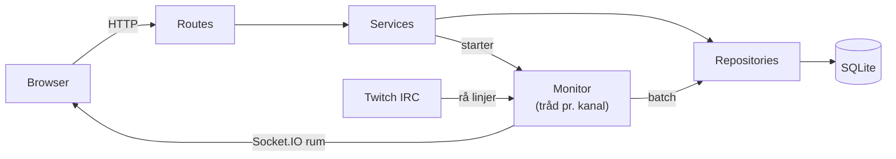
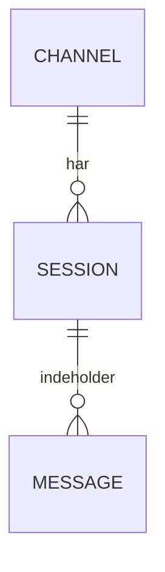

# ChatPulse
af Kevin Borup Hansen, Sep 2026 hold

## Introduktion
Streaming hjemmesider bliver større og større, de er langsomt ved at se noget af det højeste internet aktivitet, specielt live seertal (Johnson & Woodcock, 2019). Det bliver derfor vigtigere og vigtigere at forstå statestikken af sine seere, hvilke tider er engagerende, hvilke oplever frafald og de forskellige platforme sammenlignet med hinanden. 
Der findes andre løsninger der samler statestik, Twitch har deres egen samt chat. Men dette samler statistik, live chat fra flere platforme, og platform sammenligning til bedre at forstå investeringsmuligheder for sin vækst.

## Produkt
(Begrænsing: Pga. tidsbegrænsning, er produktet kun løst for Twitch, dog designet med flere platforme)
Et produkt til at samle chats på tværs af platforme, og gemme dem til at føre lokal statestik. Kan bruges til live aflæsning fra platformene. 
Løsningen bruger IRC til at aflæse chatten fra Twitch, gemmer det i vores Sqlite database og derefter udsender det via en socket, så frontend javascript kan modtage beskeder og tilføje dem til chatten.
Løsningn laver rum alt efter hvor mange kannaler overvåges i hver sin tråd, så der kan modtages beskeder fra flere platforme og flere kannaler samtidigt.

## Perspektivering
For at komme nærmere til et reelt slutprodukt, burde produktet implementere flere platforme, men også, i tilfældet af Twitch, implementere 2.0 Auth, så platformen kan sende beskeder tilbage og tage bruger handlinger til moderation. 
Samt planlagde jeg at man burde kunne åbne en session og afspille den i reel tid på livechatten. Det er hele årsagen til at messages holder på raw_line.
Samt med mere tid, ville en tkinter applikation være oplagt til at have som chat applikation til live, den ville dog være mere tynd og ikke indeholde statestik.

## AI brug
Der er gjort brug af LLM'en Claude. Claude er alene brugt til hjemmeside stil genering, altså et designframe. Derudover har jeg fordret kodelinjer til Claude, for at udfordre min C# stil til at blive mere Pythonic, så jeg kunne eksponeres til dette og genkende det yderligere i industrien. 

## Litteraturliste
- Bootstrap Team. (u.å.-b). *Get started with Bootstrap* (Version 5.3). Bootstrap. Hentet 26. oktober 2026, fra https://getbootstrap.com/docs/5.3/getting-started/introduction/
- Bootstrap Team. (u.å.-c). *Navbar* (Version 5.3). Bootstrap. Hentet 26. oktober 2026, fra https://getbootstrap.com/docs/5.3/components/navbar/
- Bootstrap Team. (u.å.-a). *Columns* (Version 5.3). Bootstrap. Hentet 28. oktober 2026, fra https://getbootstrap.com/docs/5.3/layout/columns/
- Grinberg, M. (u.å.). *Getting started*. Flask-SocketIO documentation. Hentet 26. oktober 2026, fra https://flask-socketio.readthedocs.io/en/latest/getting_started.html
- Twitch Interactive. (u.å.). *IRC concepts*. Twitch Developers. Hentet 27. oktober 2026, fra https://dev.twitch.tv/docs/chat/irc/
- Pallets. (u.å.-a). *Application factories*. Flask documentation. Hentet 27. oktober 2026, fra https://flask.palletsprojects.com/en/stable/patterns/appfactories/
- Pallets. (u.å.-b). *Modular applications with blueprints*. Flask documentation. Hentet 27. oktober 2026, fra https://flask.palletsprojects.com/en/stable/blueprints/
- Pallets. (u.å.-b). *jinja-filters.tojson*. Jinja documentation. Hentet 29. oktober 2026, fra https://jinja.palletsprojects.com/en/stable/templates/#jinja-filters.tojson
- Python Software Foundation. (u.å.-a). *sqlite3: DB-API 2.0 interface for SQLite databases*. Python documentation. Hentet 27. oktober 2026, fra https://docs.python.org/3/library/sqlite3.html#sqlite3-placeholders
- Python Software Foundation. (u.å.-b). *unittest: Unit testing framework*. Python documentation. Hentet 29. oktober 2026, fra https://docs.python.org/3/library/unittest.html#organizing-test-code
- Johnson, M. R., & Woodcock, J. (2019). "It's like the gold rush": The lives and careers of professional video game streamers on Twitch.tv. *Information, Communication & Society, 22*(3), 336–349. https://doi.org/10.1080/1369118x.2017.1386229